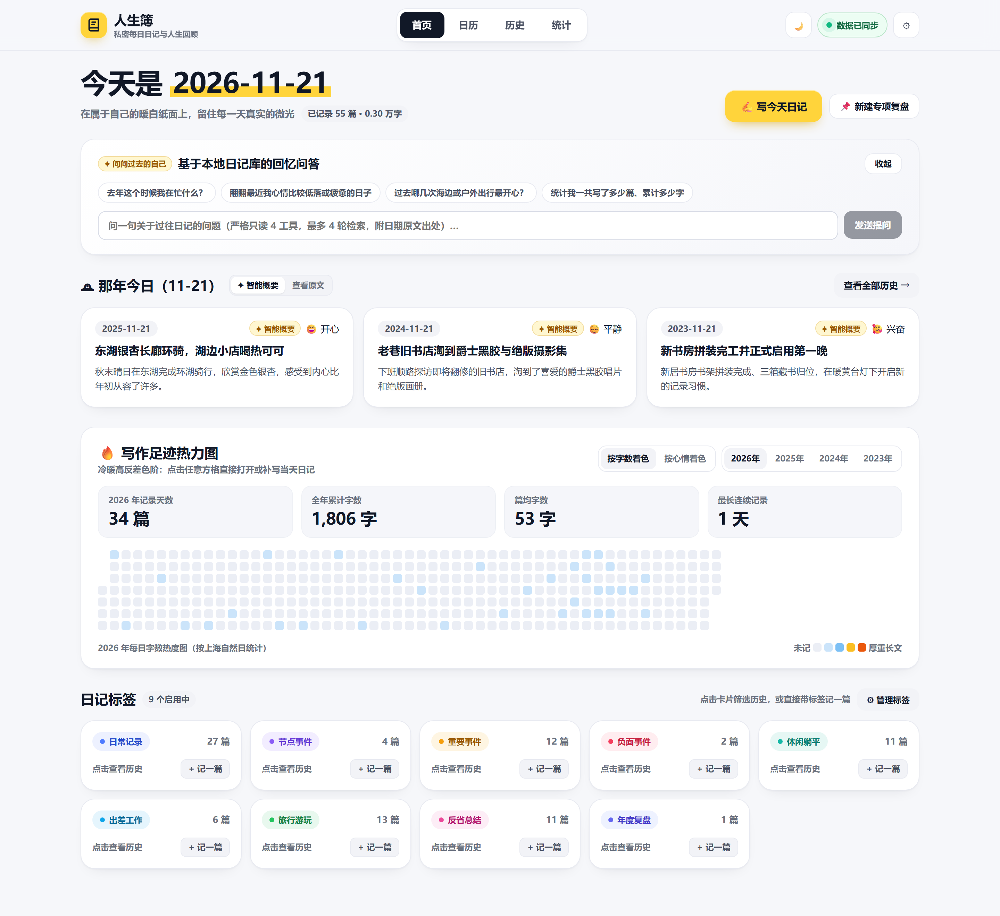
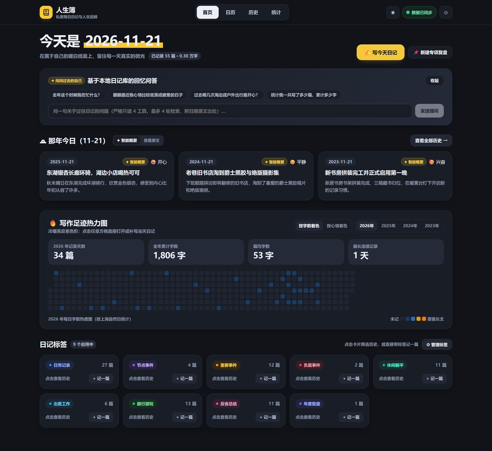
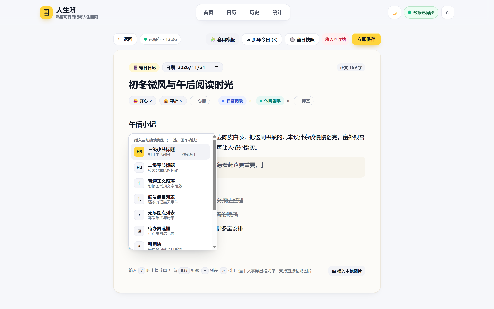
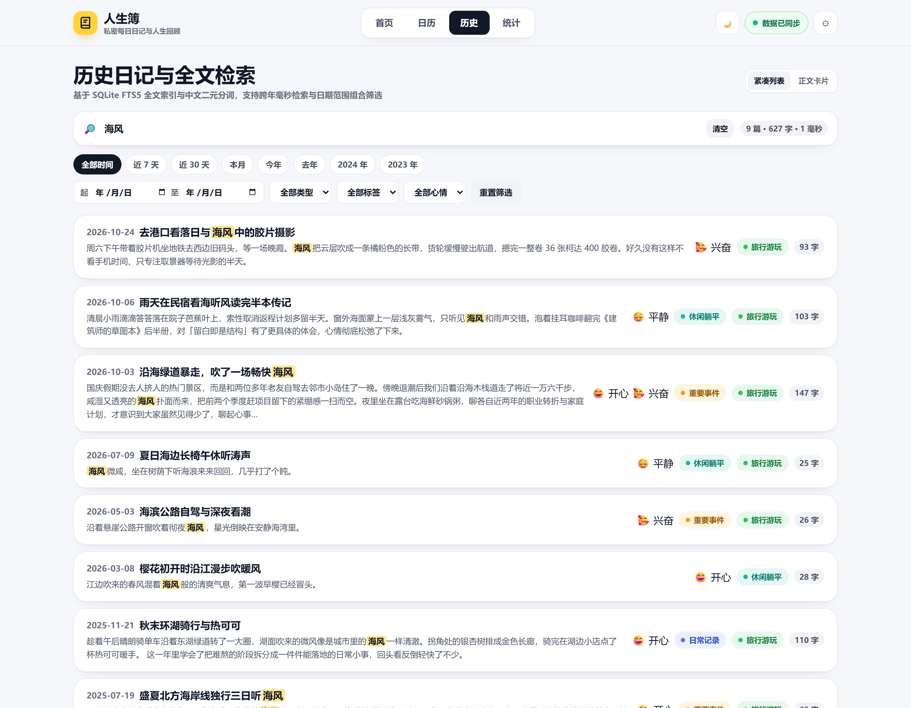
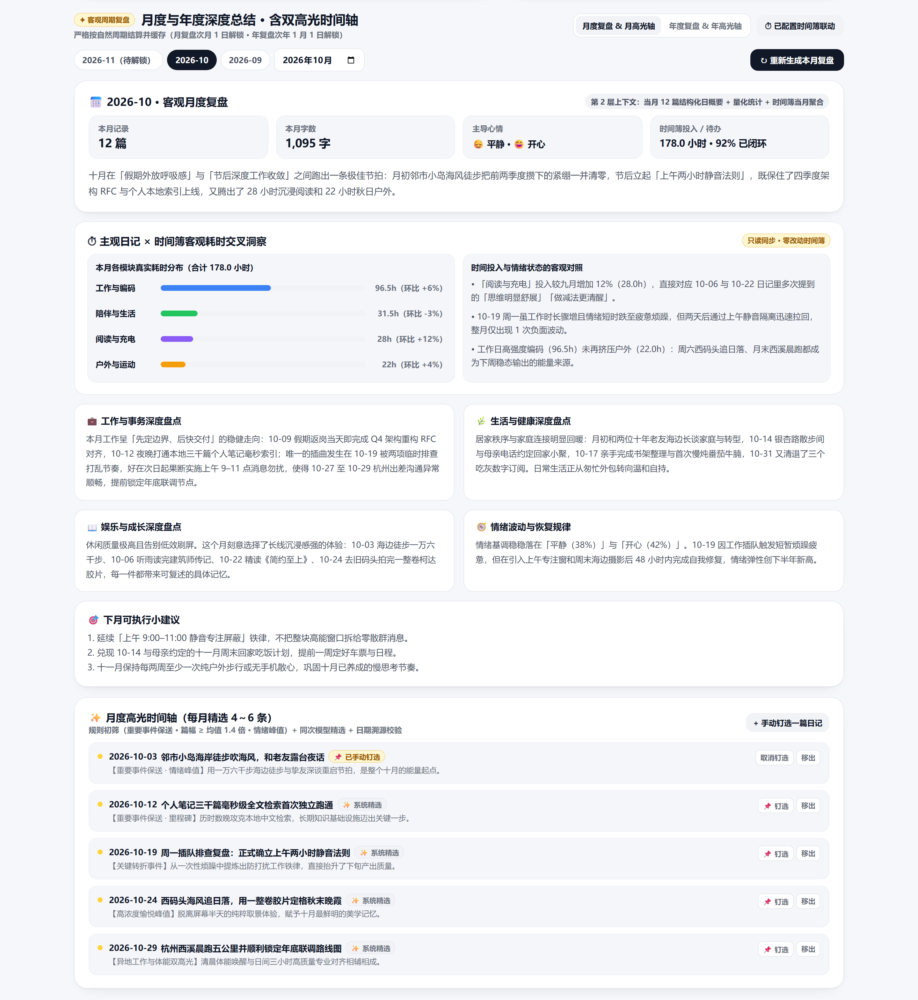
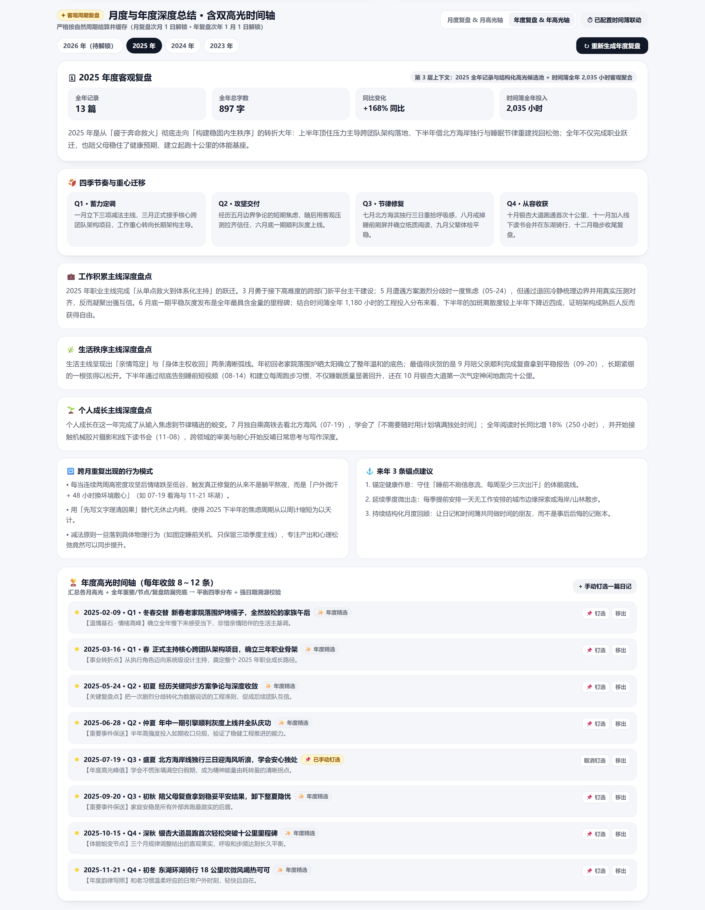

<div align="center">

# 📖 人生簿（Lifebook）

**面向个人的私密、轻快、高颜值每日日记与人生回顾工具**

自托管私有存储 · 桌面与手机 `PWA` 全屏同步 · `TipTap` 块级斜杠写作 · 原平台无损迁移 · 深度月/年复盘

[功能亮点](#-核心特性) · [界面预览](#-界面预览) · [快速开始](#-快速开始) · [数据安全与备份](#-数据安全与备份) · [NAS 部署指南](docs/绿联NAS部署与使用指南.md) · [更新版本 `v0.1.1`](https://github.com/kkuxb/lifebook/releases/tag/v0.1.1)

</div>

---

## 💡 为什么做「人生簿」

传统的云端笔记或日记应用往往把写日记变成了「内容托管在他人服务器上」与「堆满社交广告的重客户端」，想回看几年前的今天、跨年搜一句话、或者按月客观复盘生活与工作投入时，往往既慢又缺乏隐私控制。

**人生簿（Lifebook）** 与家庭时间管理项目「时间簿（Timebook）」保持同一套干净克制的视觉家族基因，但彻底专为**私密长文写作与跨年记忆回顾**打造：

- **数据只存在你自己的硬盘或家庭 `NAS` 里**：单一 `SQLite` 数据库与本地图片目录，零第三方埋点，支持每天自动在线热备与完整 `JSON` / `Markdown` 压缩包导出。
- **把过去写过的日记变成可对话、可沉淀的时间资产**：内置毫秒级 `SQLite FTS5` 全文检索、「那年今日」自动对照、「问问过去的自己」只读回顾问答，以及按自然月/自然年解锁的深度复盘与双高光时间轴。
- **不绑定模型也不强迫联网**：所有增强总结能力均可一键开关、本地直连任意三协议接口（兼容格式 / 原生双协议）；即使完全不配置接口密钥，日常写作、检索、统计、导入导出均 `100%` 流畅零报错。

---

## ✨ 核心特性

### 1. 双主题护眼纸面与全屏桌面 / 手机体验
- **护眼暖白纸面 × 夜间深色模式**：针对白天桌面长文写作与深夜熄灯回顾单独调校双套语义化色板，右上角一键切换并自动记忆偏好。
- **自适应 `PWA` 应用**：电脑宽屏顶栏工作台与手机端底栏四栏（首页 · 日历 · 历史 · 统计），手机浏览器选择「添加到主屏幕」即可作为独立全屏应用运行。

### 2. 块级斜杠写作与当日防膨胀快照
- **流畅块级编辑器**：基于 `TipTap` 打造，正文键入 `/` 随时唤出块菜单插入章节标题（`H2`/`H3`）、待办复选框、引用块、列表与本地图片上传；划词即时浮出加粗、高亮与结构格式化工具条；右侧边栏支持同步翻看「那年今日」与近期摘要对照。
- **断网续传与防膨胀快照**：输入即草稿暂存、断网本地缓冲、重连后自动同步不丢字；每篇日记默认按 `Asia/Shanghai` 自然日最多保留 **当日最新 `5` 份** 历史快照，跨入下一自然日保存或服务启动时自动清理昨日过期快照，从源头杜绝数据库无限膨胀。

### 3. 毫秒级全文检索与「问问过去的自己」
- **`SQLite FTS5` 中文检索**：内置二元中文分词索引，实测千余篇日记体量下关键词检索在 `1 ~ 5` 毫秒内返回并荧光高亮，支持「近 `7` 天 / `30` 天 / 本月 / 今年 / 去年 / 历年」快捷时间胶囊及类型、标签、心情多维组合筛选。
- **严格只读的回忆问答**：首页「问问过去的自己」仅向大模型开放 `4` 个只读查询工具且硬性限制最多 `4` 轮检索，展示可折叠思考与工具调用轨迹，回答句末附带可直接点击跳转原文的真实日期出处胶囊，不留胡编空间。

### 4. 原平台历史日记无损搬家（`ZIP` 导入与批次撤销）
- 上传原平台导出 `ZIP` 压缩包后先展示**完整导入预览**：自动剔除空白占位草稿、智能剥离标题中的重复日期前缀、自动执行「旧 `12` 项 → 新 `8` 档心情」归并映射（支持手工微调）。
- 对同日已有日记逐条提供「跳过并保留已有 / 合并追加 / 覆盖写入」三种处理策略，并按批次记录导入明细，支持**一键按批次安全撤销回滚**。

### 5. 深度月/年复盘、双高光时间轴与「时间簿」只读联动
- **自然周期防偷跑解锁**：月度复盘严格按自然月在**次月 `1` 日**解锁，年度复盘在**次年 `1` 月 `1` 日**解锁，可随时切换查看过往已结算月份与年份并本地缓存。
- **主观日记 × 客观耗时交叉洞察**：可选只读对接你的自托管「时间簿」服务，拉取同期各模块投入小时数与待办闭环率，对比主观情绪波动得出交叉分析；时间簿离线或未开启时自动平滑降级为纯日记深度复盘。
- **深度盘点而非浅层敷衍**：月度覆盖「工作事务 · 生活健康 · 娱乐成长 · 情绪规律」四维深度展开与次月可执行建议；年度支持「四季演化 · 工作积累/生活秩序/个人成长三线深度盘点 · 跨月规律与来年锚点」。
- **月 / 年双高光时间轴**：采用「规则初筛（重要事件保送 · 篇幅超均值 · 情绪峰值）+ 模型精选 + 真实日期溯源校验」防止幻觉虚构日期，并支持手动「钉选 / 移出」，重新生成复盘仍严格保留用户手选锁定结果。

### 6. 标签与心情安全迁移机制
- 内置 `9` 个常用彩色标签与新 `8` 档情绪图标，支持自定义新增、调色、重命名与停用。
- 删除已关联历史日记的标签或心情时，接口与界面均**强制要求先指定一个替换目标**并自动去重合并，彻底杜绝误删标签导致日记归类丢失。

---

## 📸 界面预览

<table>
  <tr>
    <td width="50%" align="center">
      <b>首页工作台 · 护眼暖白纸面模式</b><br />
      <a href="docs/screenshots/01-home-light.png"></a>
    </td>
    <td width="50%" align="center">
      <b>首页工作台 · 夜间深色护眼模式</b><br />
      <a href="docs/screenshots/02-home-dark.png"></a>
    </td>
  </tr>
  <tr>
    <td width="50%" align="center">
      <b>块级写作台 · 键入 <code>/</code> 呼出快捷块菜单</b><br />
      <a href="docs/screenshots/03-editor-slash.png"></a>
    </td>
    <td width="50%" align="center">
      <b>历史日记 · <code>FTS5</code> 毫秒检索与高亮筛选</b><br />
      <a href="docs/screenshots/04-history-search.png"></a>
    </td>
  </tr>
  <tr>
    <td width="50%" align="center">
      <b>月度深度复盘 · 时间簿投入交叉洞察与月高光轴</b><br />
      <a href="docs/screenshots/05-stats-monthly.png"></a>
    </td>
    <td width="50%" align="center">
      <b>年度深度复盘 · 四季演进、三线盘点与年高光轴</b><br />
      <a href="docs/screenshots/06-stats-yearly.png"></a>
    </td>
  </tr>
</table>

---

## 🚀 快速开始

### 方式一：使用 `Docker Compose` 部署（推荐 · 适配绿联 `NAS` 与 `Linux` 服务器）

默认使用 **`3220`** 端口（避免与同系列「时间簿」常用的 `3210` 端口冲突），生产构建为双阶段瘦身镜像。

1. **克隆项目并准备环境配置**：
   ```bash
   git clone https://github.com/kkuxb/lifebook.git
   cd lifebook
   cp .env.example .env
   ```

2. **按需确认环境变量与挂载路径**：
   - 如需部署在普通 `Linux` 服务器（非绿联 `/volume1/docker/...` 路径），可将 `docker-compose.yml` 中的宿主机挂载目录修改为本地目录（如 `./data:/data`）。
   - 若在 `.env` 中留空 `APP_PASSWORD`，首次打开网页时会弹出向导页让你直接设置私人访问口令。

   <details>
   <summary>查看仓库默认 <code>docker-compose.yml</code> 配置</summary>

   ```yaml
   services:
     lifebook:
       build:
         context: .
         dockerfile: Dockerfile
       container_name: lifebook
       restart: unless-stopped
       ports:
         - "3220:3220"
       environment:
         - PORT=3220
         - DATA_DIR=/data
         - TZ=Asia/Shanghai
         - APP_PASSWORD=${APP_PASSWORD:-}
         - APP_SECRET=${APP_SECRET:-}
       volumes:
         - /volume1/docker/lifebook/data:/data
       healthcheck:
         test: ["CMD", "wget", "-qO-", "http://127.0.0.1:3220/api/health"]
         interval: 30s
         timeout: 5s
         retries: 3
         start_period: 10s
   ```

   </details>

3. **构建并启动容器**：
   ```bash
   docker compose up -d --build
   ```
   待十余秒后验证健康检查接口：
   ```bash
   curl http://127.0.0.1:3220/api/health
   ```
   浏览器打开 `http://<你的服务器地址>:3220` 即可开始写下第一篇日记（更详细的绿联 `DXP4800 Plus` 操作指引见 [NAS 部署与使用指南](docs/绿联NAS部署与使用指南.md)）。

---

### 方式二：本地源码开发与运行（需 `Node.js >= 20`）

```bash
# 1. 克隆仓库并安装工作区依赖
git clone https://github.com/kkuxb/lifebook.git
cd lifebook
corepack pnpm install

# 2. 复制并配置环境变量（本地默认 DATA_DIR=./workspace-data/lifebook）
cp .env.example .env

# 3A. 开发模式（分别开启后端与前端热重载开发服务器）
corepack pnpm dev:api
corepack pnpm dev:web

# 3B. 生产构建并单进程运行
corepack pnpm build
node apps/api/dist/server.js
```

> 本地单进程构建运行后，同样通过 `http://127.0.0.1:3220` 访问；若启动后端热重载与前端开发服务器，前端开发地址 `http://localhost:5173` 会自动将 `/api` 请求代理至本地 `3220` 端口。

---

## ⚙️ 环境变量说明

| 变量名 | 默认值 | 说明 |
| --- | --- | --- |
| `PORT` | `3220` | 服务监听端口 |
| `DATA_DIR` | `./workspace-data/lifebook`（容器内 `/data`） | 数据库、上传图片、自动热备与主密钥的唯一持久化根目录 |
| `TZ` | `Asia/Shanghai` | 严格控制自然日快照清理周期及月度/年度复盘解锁日期 |
| `APP_PASSWORD` | 空（网页首次引导设置） | 私人访问口令；也可不写入配置文件，首次打开网页自行设定 |
| `APP_SECRET` | 空（自动生成 `.master.key`） | 用于 `AES-256-GCM` 加密保存外部接口密钥与会话签名的主密钥 |

---

## 🔒 数据安全与备份

所有用户运行状态只保存在单一持久化目录 `DATA_DIR` 中，迁移整套历史日记只需打包备份该目录即可：

| 存储位置（相对 `DATA_DIR`） | 内容说明 | 安全与备份机制 |
| --- | --- | --- |
| `lifebook.sqlite` | 日记全文、`FTS5` 索引、标签心情、结构化日概要与复盘缓存 | 开启 `WAL` 日志模式并支持每日后台在线安全热备 |
| `uploads/` | 正文中粘贴或上传的原始图片文件 | 自动按内容类型白名单校验（单图上限 `10MB`），随导出包一并打包 |
| `backups/` | 每日定时或设置页手动触发生成的只读 `SQLite` 热备文件 | 与运行库隔离，可在设备损坏时直接恢复 |
| `.master.key` | 本地自动生成的 `32` 字节 `AES-256-GCM` 主密钥文件 | 权限 `0600` 保护；密钥入库加密后返回接口始终掩码脱敏 |
| 外部登录与防爆破 | 口令 `scrypt` 随机盐哈希校验，会话基于 `HttpOnly` 签名凭证 | 连续输错口令达阈值自动触发 `429` 限流冷却锁定 |

> 另可在网页右上角「设置 → 数据导入与导出」中随时导出完整的便携 `JSON` 备份或图文完整可读的 `Markdown + 图片` 压缩包，确保任何情况下不锁死你的个人写作记录。

---

## 📁 目录结构与常用命令

```text
lifebook/
├── apps/
│   ├── api/                 # 后端服务（Hono + SQLite + FTS5 + 加密/复盘/热备）
│   └── web/                 # 前端单页与 PWA（React 19 + TipTap + Vite）
├── packages/
│   └── core/                # 共享领域类型、上海时区日期规则、高光算法与提示词模板
├── docs/
│   ├── screenshots/         # 开源展示高清截图
│   ├── designs/             # 需求冻结设计、实施与独立测试方案
│   ├── deliveries/          # v0.1.0 验收记录与测试报告
│   ├── 设计规范.md          # 护眼双主题视觉与动效设计规范（v0.1.0）
│   └── 绿联NAS部署与使用指南.md
├── Dockerfile               # 双阶段多架构轻量化容器构建配置
├── docker-compose.yml       # 家庭 NAS / 服务器容器编排文件
└── .env.example             # 环境变量参考模板
```

常用工程校验命令：

```bash
corepack pnpm typecheck      # 全工作区 TypeScript 严格类型检查
corepack pnpm test           # 运行 core 与 api 自动化测试套件（Vitest）
corepack pnpm build          # 构建 core、web 前端及 api 服务端产物
```

---

## 📄 开源协议与文档导航

- **开源协议**：基于 [`MIT License`](LICENSE) 协议开源，欢迎自由自托管、二次定制与贡献改进。
- **相关文档**：
  - [文档总索引](docs/README.md)
  - [视觉与动效设计规范（`v0.1.0`）](docs/设计规范.md)
  - [绿联 `NAS` 部署与使用指南](docs/绿联NAS部署与使用指南.md)
  - [一期开发验收记录（`v0.1.0`）](docs/deliveries/lifebook-v0.1.0-acceptance.md)
